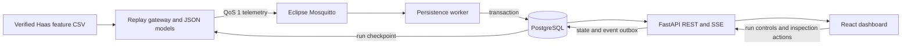

# Architecture and technology stack

The canonical local deployment has five services named `postgres`, `mqtt`, `api`, `worker`, and `gateway`. The API serves the built React app from the same origin. The gateway evaluates completed recorded cuts using verified nested-workpiece models, and the worker persists each MQTT event before acknowledgment. Session-scoped run state and a transactional event outbox drive browser updates.



## Runtime choices

| Layer | Selected technology | Purpose and decision |
|---|---|---|
| Training | Python 3.12, NumPy 2.4.2, scikit-learn 1.8.0 | CPU logistic regression, grouped validation, temperature selection and metrics. Small source data makes a GPU unnecessary for the initial models. Training packages stay outside the runtime image. |
| Runtime model | Versioned numeric JSON and `pdm.inference` | Feature order, standardization, linear logits, temperature and class mapping are explicit. Runtime validates model hash against its report. Load artifacts only from the configured trusted directory. |
| Virtual edge | Python `pdm.gateway`, Paho MQTT 2.1.0 | Read run checkpoints, replay original cycle order, score current evidence, control optional vibration release and publish events. |
| Messaging | Eclipse Mosquitto 2, MQTT, QoS 1 | Local industrial publish/subscribe path, durable broker volume and application-level duplicate suppression. The worker uses MQTT 5 with session expiry and manual acknowledgment. |
| Persistence | PostgreSQL 17, psycopg 3.3.3 | Canonical multi-process run state, transactional event acceptance, work orders and outbox. SQLite WAL is also supported for single-host development and focused tests. |
| API | FastAPI 0.135.1 and Uvicorn 0.41.0 | Same-origin REST, schema validation, session boundary, export and SSE. SSE uses native browser reconnect and persisted cursors. |
| UI | React 19.2, TypeScript 5.9, Vite 7, ECharts 6, Lucide icons | Interactive run controls, charts, inspection queue and research evidence. `package-lock.json` resolves exact package versions. Vite builds the static bundle served by FastAPI. |
| Packaging | Multi-stage Dockerfile, Docker Compose | Node 22 build stage, Python 3.12 runtime, non-root UID 10001, PostgreSQL/Mosquitto volumes, localhost API bind. |
| Observability | Structured Python logs and Prometheus text endpoint | Counts of runs, accepted cuts, optional releases and ingested payload bytes. Worker and gateway heartbeat state supports readiness diagnosis. |

The manifests and lockfile are authoritative for package versions. FastAPI and Paho use MIT/EPL/EDL licensing respectively, NumPy and scikit-learn use BSD-family licenses, React and Vite use MIT, ECharts uses Apache 2.0, and PostgreSQL uses the PostgreSQL License. Verify notices from the resolved packages when producing a distribution. The dataset has a separate CC BY 4.0 notice. [FastAPI license](https://github.com/fastapi/fastapi/blob/master/LICENSE) · [Paho Python licensing](https://github.com/eclipse-paho/paho.mqtt.python) · [NumPy license](https://github.com/numpy/numpy/blob/main/LICENSE.txt) · [Scikit-learn license](https://github.com/scikit-learn/scikit-learn/blob/main/COPYING) · [PostgreSQL license](https://www.postgresql.org/about/licence/) · [ECharts license](https://github.com/apache/echarts/blob/master/LICENSE)

## Telemetry and state contract

A version-1 telemetry event contains `run_id`, `generation`, `source_version`, `tool_id`, original `cycle`, `replay_at`, `event_type`, `quality`, `features`, and `vibration_released`. A scored cut also carries `decision` with risk, actionable risk, status, slot, counters, reason and `model_version`. The worker stamps `received_at` and records wire bytes. Types are `cut`, `gap`, or `damage`. Quality covers `ok`, `gap`, `conflict`, `unsupported`, or `missing`.

Data is isolated by run and generation. The database key `(run_id, generation, cycle)` rejects repeated acceptance. In a transaction, the store validates the expected next cycle, increments eligible and release counters, inserts the reading, optionally creates the first inspection draft, writes corresponding outbox events, and advances the checkpoint. The worker acknowledges after commit. A valid duplicate is idempotent. Invalid packets are rejected and acknowledged to prevent a poison record from blocking the subscription. A database failure leaves delivery unacknowledged for recovery.

The gateway publishes the next cut only after its durable checkpoint advances. Repeated publication while awaiting persistence is safe at the ingestion boundary. Restarting a run increments `generation`, resets active state, and invalidates packets from older generations. Worker, gateway and API must share the same database URL and MQTT topic. The release runs one gateway and one persistence worker. Horizontal gateway coordination is a future scaling change requiring a leased run owner or advisory lock.

The gateway's default model directory is `artifacts/nested-workpiece`. Its `models.json` is checked against `report.json` before inference. The model selected for a benchmark cutter excludes that cutter's entire workpiece component. This held-out replay model selection is a benchmark contract. The runtime calculates both current and fused scores from the buffered source before selecting the transmitted payload, so its measured resource scope is optional-feature release and payload bytes. Compute saving requires a subsequently measured lazy-inference path. A customer asset requires a model version and validated source mapping established during onboarding. The dataset's evaluation-only damage endpoint is not a real controller input.

## Public API

All `/api` routes use a browser session created by `GET /api/session`. Mutating API requests require JSON and an allowed same-origin request. Responses are private and uncached. Pydantic rejects extra run-input fields. Sessions use random HttpOnly, SameSite Strict cookies, SHA-256 token identifiers in storage, and a 24-hour expiry. `PDM_DEMO_ROLE=viewer` enforces view-only operation. The anonymous local planner session is a demo identity mechanism. Customer identity and authorization mapping belong to the pilot profile.

| Route | Method and result |
|---|---|
| `/api/session` | GET creates or reads `{role}` and session cookie. |
| `/api/tools` | GET available source cutter IDs, recipe metadata, and cut counts. |
| `/api/runs` | GET own runs. POST `{tool_id, policy, speed_ms, slot_interval}` creates a run. Policy values are `current`, `periodic`, `decision`, `fused`. |
| `/api/runs/{id}` | GET `{run, readings, work_orders, cursor}` for one session-owned run. |
| `/api/runs/{id}/{pause|resume|restart}` | POST replay control. |
| `/api/runs/{id}/events?after={cursor}` | GET SSE `update` messages with `{kind, data}` and persisted numeric event IDs. `Last-Event-ID` supports reconnect. |
| `/api/runs/{id}/work-orders/{order_id}/{approve|dismiss|complete}` | POST optional `{finding}`. Planner role and transition rules apply. |
| `/api/runs/{id}/export` | GET JSON snapshot plus source attribution and interpretation. |
| `/api/evaluation` | GET installed validation report, matched policy benchmark, and source audit. |
| `/healthz` and `/metrics` | GET readiness information and Prometheus counts. |

The store defaults to four active or paused runs and thirty saved runs per session. `PDM_MAX_ACTIVE_RUNS` defaults to sixteen globally and `PDM_MAX_SESSIONS` to one hundred. Expired sessions are cleaned when new sessions are created. Capacity responses use HTTP 409 with a readable detail. Run not found across session boundaries returns 404. Session expiry requires a new dashboard session.

## Configuration and local deployment

| Variable | Default or deployment value | Use |
|---|---|---|
| `POSTGRES_PASSWORD` | Generated in local `.env` | Compose requires a URL-safe database password. Keep `.env` local. |
| `PDM_DATABASE_URL` | `sqlite:///data/pdm.sqlite3` for native development, PostgreSQL URL in Compose | Shared runtime persistence. `DATABASE_URL` is also recognized. |
| `PDM_MODEL_DIR` | `artifacts/nested-workpiece` | Trusted model, report and evaluation artifact directory. |
| `MQTT_HOST`, `MQTT_PORT`, `MQTT_TOPIC` | `127.0.0.1`, `1883`, `pdm/replay/events` natively | Compose uses host `mqtt`. All telemetry participants share topic. |
| `MQTT_USERNAME`, `MQTT_PASSWORD` | Unset on isolated local broker | Authenticated external broker credentials when configured. |
| `MQTT_TLS` | `false` in local development | Worker TLS toggle. Verify both gateway and worker TLS behavior before using an external broker. |
| `PDM_ALLOWED_ORIGINS` | Current request origin | Additional trusted UI origins, comma-separated. Same-origin serving avoids cross-origin deployment complexity. |
| `PDM_SECURE_COOKIE` | Derived from HTTPS unless explicitly true | Enable for TLS proxy deployment. |
| `PDM_DEMO_ROLE` | `planner` | Set `viewer` for read-only public profile. |
| `PDM_WEB_DIR` | `web/dist` | Built frontend bundle. |
| `PORT`, `PDM_HOST` | `8000`, `127.0.0.1` for Python module entry | Native API bind. Docker command binds `0.0.0.0` inside container, published only at host localhost. |

```powershell
pwsh -File scripts/setup.ps1
docker compose up --build -d
docker compose ps
Invoke-RestMethod http://127.0.0.1:8000/healthz
```

The setup script creates the virtual environment, installs development/test dependencies, fetches verified data, builds nested workpiece models and matched benchmark, builds the web bundle, and generates `.env` if absent. Compose needs a running Docker engine. Its API host port is `127.0.0.1:8000`. The broker and database stay on the private Compose network. Review actual build and health results before calling deployment verified.

## Operating profiles and growth

**Canonical local demonstration.** PostgreSQL/Mosquitto retain volumes and runtime processes run independently. Use `docker compose logs --tail 100 api worker gateway` for diagnosis. Stop with `docker compose down`, retaining volumes. Database backup uses `pg_dump`; recovery is verified by restoring into a separate database and comparing row counts and a known run export. Broker state and model/data manifests accompany a release. Backups should be tested before customer onboarding.

**Hosted showcase.** The approved candidate is Render Free for an application container and Neon Free PostgreSQL. Provider free tiers change and can sleep. The current multi-service Compose runtime requires a deliberate hosted adaptation, process supervision, private broker, secrets, session caps, and restart tests before publication. Check current limits at release. Keep the local installation available to a reviewer. [Render free limits](https://render.com/docs/free) · [Neon free limits](https://github.com/neondatabase/website/blob/main/content/faqs/free-plan-limits-and-quotas.md)

**Customer shadow pilot.** Map controller/historian signals into a versioned adapter with source units and feature timing. Deploy a read-only connector, explicit asset IDs, customer identity, TLS broker access, database backups and approved maintenance playbooks. Retain findings with source and review status. Scale source-specific ingestion independently when measured event rates demand it. Resource-intensive raw-waveform training and additional MLOps infrastructure follow a measured need.

The current model benchmark does not show superiority for the decision-aware policy. Treat the system as a reproducible engineering and research platform with concrete release checks. Field inference validity, business benefit and customer operational readiness require the milestones in the roadmap.
