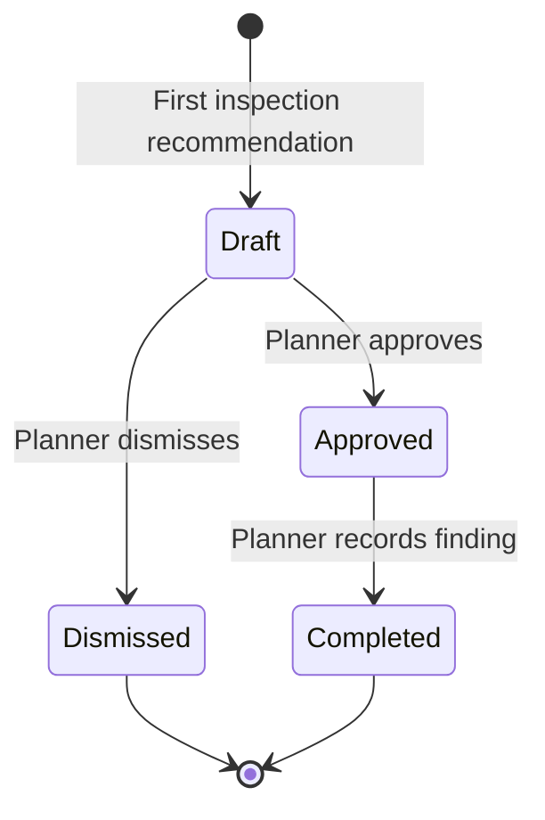

# Functional specification

KerfPulse AI presents recorded CNC tool measurements as a running industrial telemetry workflow. Its four views are **Shop floor**, **Performance**, **Evidence audit**, and **Data & method**. The browser creates a session, loads available cutters and existing session-owned runs, and shows service health. The empty state guides the user to start a replay.

## Start and control a run

The replay dialog offers a cutter life, one of four evidence policies, replay pace, and an inspection interval. Available paces are 1000 ms, 350 ms, or 100 ms per source position. The API supports 100–10000 ms. Inspection breaks are after every one, two, or three cycle positions, with three as default. The source's cycle count and recipe stay visible. A paired comparison launches the selected policy and its periodic/decision-aware counterpart using the same cutter, pace and calendar.

The submit action requires planner access. A successful creation returns a run ID, generation 1, running state and zero checkpoint. A capacity or validation response stays readable in the dialog. If paired creation succeeds only once, retain that valid run and surface the error so the user can assess the state. Replay speed changes the demonstration clock. It does not change the source cycle ordinal or the model's lead calculation.

| Run state | Available controls and behavior |
|---|---|
| `running` | Pause and restart. The gateway publishes one source position at a time from the durable checkpoint. |
| `paused` | Resume and restart. Already persisted readings remain visible. A message already in flight may complete its acceptance. |
| `completed` | Restart for a new generation. The recorded damage event closes the run. Pause/resume do not reopen it. |
| Restart response | Reset checkpoint, counters and active generation. Load the fresh snapshot and ignore stale older-generation readings. |

The run list shows cutter, policy, state and latest source cut. Selecting a run loads a consistent snapshot and opens its SSE event stream. Selecting another run closes the previous stream. A connection label distinguishes connected, reconnecting and loading conditions. Refresh uses the server snapshot to recover state.

## Shop-floor behavior

The main view focuses on the selected cutter and the latest accepted measurement. It shows the source's current cut, model risk, decision status, optional vibration release count, budget and ingested payload volume. The machine visualization reflects replay activity. Trend charts use source cycle numbers on the horizontal axis. Missing measurements remain visible as gaps or quality events. Chart traces should not imply that a measurement exists at an absent ordinal.

| Decision or source condition | User interpretation | Required presentation |
|---|---|---|
| Monitoring | Model has not requested an inspection at the current threshold. | Current risk and latest completed cut, evidence policy and model version. |
| Inspection recommended | Current evidence meets the slot-specific rule. | Proposed break after cut `s`, originating cut, reason and inspection draft. |
| Evidence deferred | More vibration evidence was requested near the threshold but release quota was unavailable. | Explicit deferral and counts. Preserve the event in evaluation. |
| Insufficient evidence | Required input or supported mapping is unavailable. | Quality/source reason with unavailable risk. |
| No feasible slot | Calendar cannot offer an eligible future inspection position for the configured horizon. | Slot availability reason and inspection status. |
| Gap/conflict | Source ordinal has no usable measurement or has conflicting records. | Original ordinal and reason. It does not increment eligible measurements or vibration quota. |
| Damage observed | Source terminal event has arrived. | Completed run and observed damage marker. Keep the preceding forecast history intact. |

The supported three-cut maximum interval keeps the implemented model horizon sufficient for the regular calendar. The broader insufficient-evidence and no-feasible-slot contract supports future adapters and calendars. Do not claim every contract state is exercised by every included fixture.

The five-cut risk is a benchmark model probability estimate made at the latest completed cut. Actionable risk is the mass for an inspection slot followed by two to five further cuts before damage. It changes with the calendar. A dark or light theme changes presentation only. State, warning meaning, and quantities must remain readable through text and numeric values.

## Inspection workflow

The database creates one inspection draft for the first qualifying recommendation in a run generation. Subsequent qualifying readings preserve the first order and its slot. This matches the first-inspection research metric and avoids repeated drafts from a sustained alarm.

Each card shows cutter ID, source cut that created it, planned break, status, model version and reason. Approve and dismiss are offered on a draft. Record completion is offered on an approved order. A completion dialog accepts a finding up to the API's 2000-character limit. Treat the finding as manually entered by the user, retain it in export, and keep its provenance distinct from published dataset labels.

A repeated successful transition returns the current state. An invalid transition returns HTTP 409 and leaves the order unchanged. Viewer access hides mutation controls, and the API independently checks the role. If the source run reaches damage before an open order is completed, the order remains an auditable disposition record. An approved planned inspection is a scheduled replay outcome. The historical trajectory continues, so the app cannot observe a prevented failure.

## Comparison, performance and evidence

The comparison view shows two runs with their policy, same source cutter and calendar. Compare optional release count and measured payload volume alongside first inspection slot. The always-fused policy is labelled as a resource reference and can exceed the 25% optional-release constraint by design. Source gaps do not become extra quota under either capped policy.

Performance uses installed report and policy artifacts from the configured model directory. Display source count and protocol, AP, Brier/reliability information, and raw per-tool inspection outcomes with denominators. Recorded nested-workpiece results give 2 timely cases for current-only and periodic and 1 for decision-aware and always-fused across 14 tools. The data and model method view explains the one-machine origin, grouped validation, optional-feature release cap, and current result. No advantage should be implied by visual styling or defaults.

Evidence audit lists persisted source events in cycle order, including quality, event type, release flag and decision. Use it to trace why an inspection draft appeared and to inspect gap/conflict handling. Data & method links the pinned source, license, feature contract and method documentation. API export includes the run snapshot, readings, work orders, source provenance and interpretation.

## Failure and recovery interactions

| Trigger | Service response | Browser behavior |
|---|---|---|
| Dataset unavailable or checksum mismatch | Tool listing fails with a readable unavailable response. | Explain source readiness and retain retry action. |
| API unavailable | Network or HTTP error. | Preserve displayed evidence and show reconnect/retry status. |
| SSE disconnect | Native EventSource reconnects with last event cursor. | Merge events by cycle/generation and refresh snapshot when required. |
| Worker or broker down | Heartbeat/connectivity status ages and checkpoints stop advancing. | Surface connection or stale-update information without creating invented readings. |
| Duplicate telemetry | Store returns idempotently with no side effect. | One row, one quota change, one work-order draft. |
| Out-of-order or invalid packet | Worker rejects packet and records rejection time. | Affected run does not skip the required next source position. |
| Session expired | API returns unauthorized and stream closes. | Request a fresh session and reload its available runs. |
| Another session's run ID | API returns 404. | Explain unavailable run and retain own run list. |
| Capacity reached | API returns 409. | Display the limit and permit selection of an existing run. |

## Reviewer walkthrough and acceptance

1. Start the local stack and confirm health. Open the dashboard and read the recorded-telemetry label and data-source information.
2. Start cutter 2 under current-only with a three-cut calendar at 1000 ms. Observe source gaps and the quarantined conflict around cycle 34. Eligible count advances only for usable records.
3. Start periodic or decision-aware replay of the same cutter. Verify optional releases obey the prefix cap and compare first proposed inspection slot. At the recorded nested defaults, current/periodic produces the earlier timely slot for this cutter.
4. Approve a draft, record a clearly marked demonstration finding, and export the run. Verify source attribution and the finding match the UI.
5. Pause/resume, reload the page, and restart. Verify checkpoint continuity and a fresh generation on restart.
6. Run cutter 11. Observe first-cut damage and no preceding measured warning opportunity.
7. Open Performance and inspect the complete all-tool result. A selected illustrative cutter cannot replace the full benchmark.

Release verification records actual browser, API and transport outcomes. Keyboard navigation, responsive presentation, focus handling, chart accessibility, disconnection recovery and session isolation are checked before a public demonstration. An external plant pilot adds its own controller mapping, calendar and maintenance-result contract.
