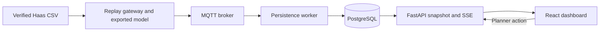

# How KerfPulse AI works

KerfPulse AI is a software replay of a CNC predictive-maintenance workflow. It feeds recorded cutting measurements into the same sequence an operator would use on a connected system: receive sensor evidence, estimate the risk of cutter damage, find an inspection window, and record the decision. Replay time controls how quickly the dashboard moves. Original cycle numbers preserve the order of the experiment.

## The dataset used

Training, evaluation and replay use one dataset: *A new open dataset from a milling process – data for classification and estimation of tool life*, by Grzegorz Piecuch and Tomasz Żabiński, published in *Scientific Data* in 2025. The pinned Figshare release is `10.6084/m9.figshare.28589216.v1`, licensed CC BY 4.0. The study measured 14 cutting tools on a three-axis Haas VF-1 while milling 42CrMo4 steel in controlled conditions. Damage means complete cutter breakage or breakage of a blade. The experiment contains 968 recorded milling cycles. [Paper](https://pmc.ncbi.nlm.nih.gov/articles/PMC12006439/) · [Pinned release](https://doi.org/10.6084/m9.figshare.28589216.v1)

| Data | What it represents | How KerfPulse uses it |
|---|---|---|
| 12 current channels at 500 Hz | Electrical load on spindle and X/Y/Z drives | 72 completed-cut statistics used by the current model |
| Eight vibration channels at 25 kHz | Accelerometers on spindle and machine axes | 48 completed-cut statistics available to the fused model and optional transmission policy |
| Cut ordinal and machining context | Age in cuts, tool type, axial/radial depth, toolholder length and workpiece hardness | Model inputs with the assumption that the application knows these settings before the decision |
| Cutter identity and workpiece identity | Experimental grouping and lineage | Split construction and auditing |
| CycleToFailure and terminal status | Published remaining-cycle label and observed damage | Training/evaluation targets and replay damage marker, with terminal sensor features excluded |

Each sensor contributes six statistics per cut: minimum, maximum, mean, standard deviation, skewness and kurtosis. The app uses the 1,797,280-byte processed CSV, with 131 columns including metadata. The source raw archive is approximately 25.35 GB. The app does not need that file. Source clock information in the processed table is cut order, so the live display uses system replay timestamps. The raw sampling rates describe acquisition hardware in the published experiment. The app sends one summary per accepted cut, at the selected replay pace. [Publisher CSV and metadata](https://api.figshare.com/v2/articles/28589216) · [Data records and sensor method](https://pmc.ncbi.nlm.nih.gov/articles/PMC12006439/)

### Setup, cleaning and splitting

1. `python -m pdm.dataset fetch` downloads the pinned CSV and checks byte length and SHA-256 (`e125471f983e98ae326e2c47e15f633bb30738e285b9ad6e54b5e364d4d66dbc`).
2. The parser handles two header rows, semicolon separators, decimal commas in metadata and the published `TollIndex` field. It preserves 21 missing ordinals and quarantines both records for tool 2, cut 34. After excluding those two rows and all 14 terminal rows, **952 measured pre-damage cuts** remain. Tool 11 damaged on its first cut and offers zero preceding measurements.
3. Nested workpiece evaluation holds out connected groups of cutters that shared workpieces. Recipe evaluation holds out a cutting recipe and also excludes any tools with workpieces linked to the test tools. Inner folds select regularization and probability temperature from training groups. Scalers fit inside each training fold.
4. Each multinomial logistic model estimates nine buckets for cuts remaining: one through eight, plus more than eight. It loads as verified coefficients and scaler parameters in the replay gateway. The deployed showcase uses the saved workpiece-disjoint models and applies the held-out model associated with the selected cutter. The recipe holdout is a separate stress study. Stiehl, Bosch, wind and other datasets discussed in the research documents were evaluated as candidates. They did not train or test this release. [Stiehl dataset and distinct wear endpoint](https://data.mendeley.com/datasets/zpxs87bjt8/3)

## What happens between a cut and the dashboard

- **Replay gateway.** Reads the next source cycle for each running cutter, scores a completed cut, and attaches any inspection decision. A gap or conflict travels as a quality event. Damage travels as an observed terminal event with no inference features.
- **Evidence policy.** Current-only transmits current summaries. Periodic also transmits vibration every fourth eligible cut. Decision-aware requests vibration when the current estimate lies near the action threshold. Both budgeted policies stay within `floor(eligible cuts / 4)` after every eligible cut. Always-fused sends both as a resource reference. The gateway currently computes both model outputs before choosing which evidence to transmit. Feature payload savings measure bandwidth, and both predictions still incur computation.
- **Inspection logic.** Five-cut risk is the estimated probability of damage in the next five cuts. Actionable risk uses a different window: two to five cuts after the next scheduled inspection break. At the fixed threshold of 0.50, a qualifying score can produce a draft. Only the first draft is counted in the benchmark. The application records a planner’s action and written finding. Actual prevention would require a field intervention study.
- **Persistence and refresh.** Mosquitto transports messages using QoS 1. The worker persists a reading, progress checkpoint, optional draft, and browser notification as a transaction, then acknowledges the packet. Run ID, generation and original cycle identify a unique reading. The browser loads a snapshot and follows server-sent events (SSE). A restart creates a new generation. The SSE stream can resume from its last event ID.
- **Access.** A 24-hour HTTP-only session isolates one demo workspace from another. The planner can act on their orders. A viewer deployment can browse without making changes. This release uses demo session identity; plant deployment needs customer identity and an access review.

## Reading the web application

| View | What it shows | What the operator can do |
|---|---|---|
| Shop floor | Haas machine illustration, selected cutter, cycle counter, benchmark risk, vibration allowance, inspection queue and replay timeline | Start, pause, resume, restart, select a cutter, inspect details, approve/dismiss a draft, record completion and export |
| Performance | Risk curves, evidence release markers, paired runs, payload counts and held-out policy outcomes | Compare policies and see if a warning arrives in time under the same replay schedule |
| Evidence audit | Individual cycles, quality gaps, model version, decision reason, planned break and released features | Filter inspection, deferred and quality events, inspect signal summaries and trace forecast lineage |
| Data and method | Source study, license, sensor setup, data cleaning and evaluation definitions | Verify attribution and understand what the metrics measure |

On the chart, orange shows five-cut damage risk, dashed green shows actionable risk, and a diamond marks a cut whose vibration summary was released. A zero release count can be expected with current-only. A gap is an unavailable observation. The archive’s damage marker denotes what happened in the published experiment, even if the replay planner approves an inspection. Light and dark themes represent the same underlying run.

In a shop-floor pilot, this design could help engineers compare review burden and communication budgets before connecting a machine. The current result favors current-only at the evaluated settings. Signals and tooling conditions will shift across machines; a plant would need measured compatibility, input availability, shadow monitoring and a technician-approved operating point before relying on forecasts.
