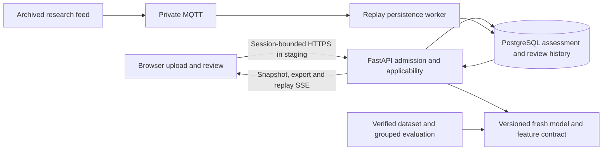
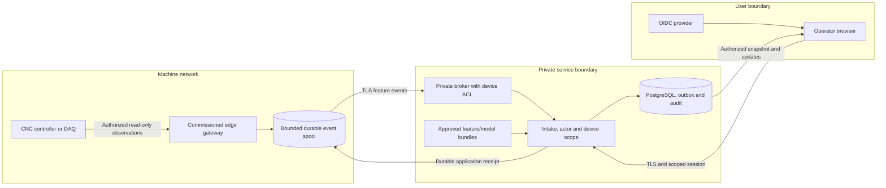
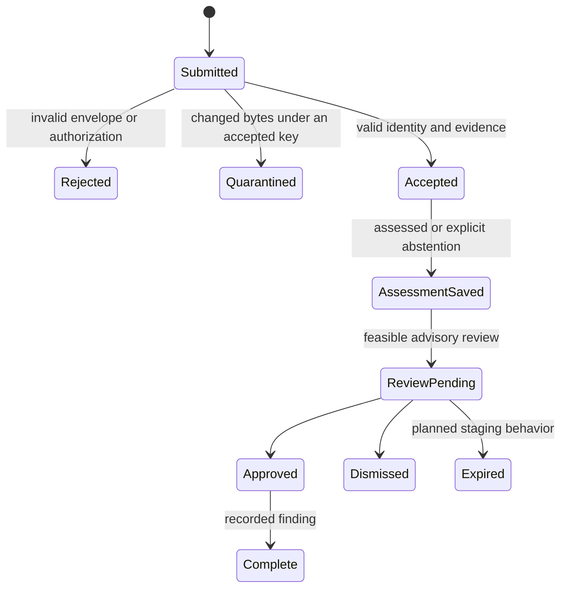

# System architecture and trust boundaries

## First release

Same-origin React and FastAPI implement the demo, with PostgreSQL durable rows. SQLite remains a local development path. Fresh inference runs in the API process because inputs are bounded numeric summaries, the logistic artifact is small, and one trusted preprocessing/inference path avoids edge/server drift. The input owner is a validated session. Artifact release and scored event persist with their digests. Adding an unfamiliar tool-life ID never changes model selection.

Replay stays on its existing routes, with its fold-specific model lookup and policy benchmark. The fresh path uses a released current-plus-context model and separate persistence, review and provenance. Explicit source labels and schema compatibility prevent mixing assessment records with independent validation evidence.

## Staging and qualified site topology

Edge handles acquisition, clock synchronization, sequence, completed-cut extraction, quality flags and buffering. Raw high-rate windows remain at the edge or in private capture storage governed by policy. Application ingress handles device scope, idempotency, ordering, evidence retention, approved inference, workflow and audit. Research owns labels, reproducible training and release review. No component issues controller write commands.

## State and transaction rules

Persist accepted evidence, assessment, proposed action and its durable notification together where emitted. Duplicate deliveries return a previously accepted identity. Recheck optimistic review version in the same transaction as transition/history write. Treat notifications as hints and database history as authoritative. Conflict evidence is now session-scoped and durable. Stage 2 adds explicit ordered device ingest, durable device receipts and bounded catch-up for fresh streams; the demo fresh history is request/snapshot based.

The deployment profiles and recovery tests are specified in [operations](deployment-and-operations.md). The [threat model](security-and-threat-model.md) defines admission across each boundary.
